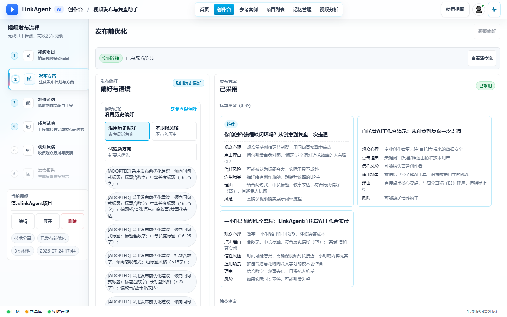
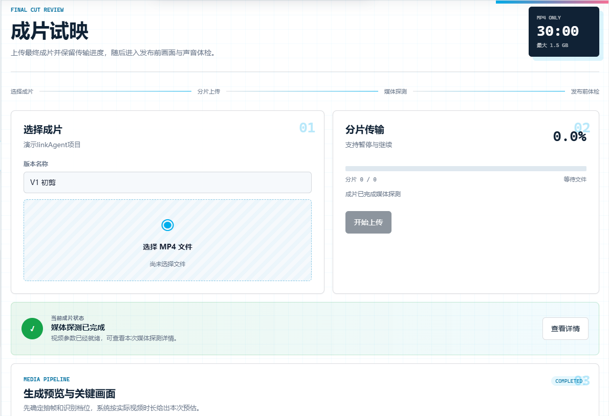
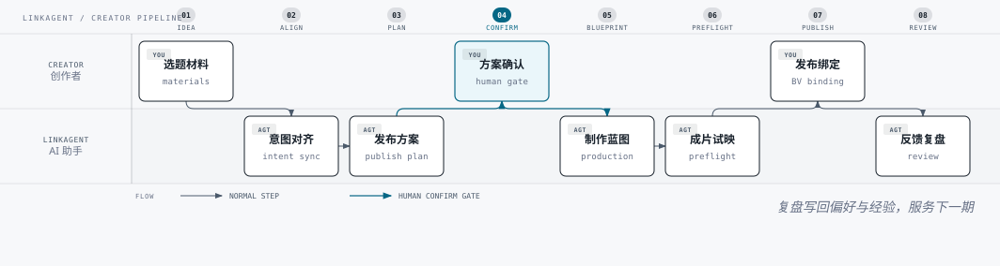
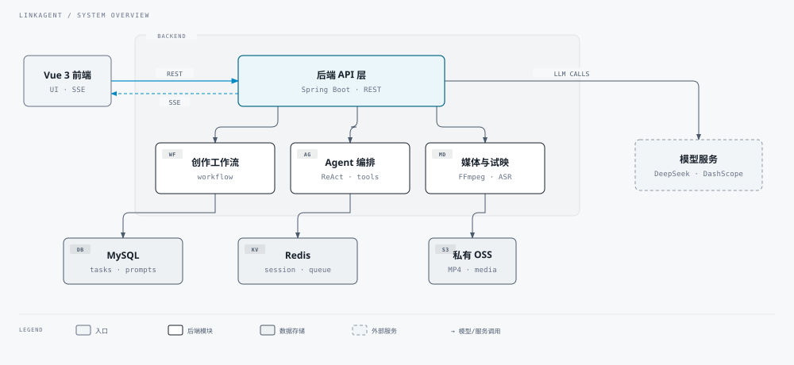

# LinkAgent

一个面向 B 站创作者的自托管 AI 工作台。它把一期视频从选题、发布方案、制作蓝图、成片试映，到发布后的评论分析和复盘，放进同一个创作任务里。

[在线演示](http://linkagent.cloud) · [快速开始](#快速开始) · [系统架构](#系统架构) · [本地开发](#本地开发)

> 演示站只用于体验和联调，数据可能随时重置。项目默认给一位创作者自托管使用，不是公开多用户 SaaS。

<table>
<tr>
<td width="50%"><br/><sub>创作台：材料、历史偏好、发布方案和风险判断放在同一页</sub></td>
<td width="50%"><br/><sub>成片试映：转写、分段审查和可追踪的修改清单</sub></td>
</tr>
</table>

## 为什么做这个

做一期 B 站视频，真正麻烦的不是写脚本，而是中间那些断点：选题在脑子里、材料在文件夹里、发布方案和实际成片对不上、评论区的反馈过两周就找不到了。每个环节都有工具，但它们不共享同一个任务上下文。

LinkAgent 用“创作任务”把这些串起来：一个任务里保存材料、AI 建议、人工决策、成片版本和发布后数据。AI 不替创作者拍板，只在几个明确的节点干活：理解意图、生成方案、拆制作步骤、做试映分析；发布方案、制作蓝图、成片试映这些关键动作必须由人确认后才继续。

## 一条视频怎么走



流程里有两个硬约束：

1. **发布方案必须人工确认**。AI 只在想法对齐之后、由创作者主动触发生成方案；生成过程中有独立审查，发现偏离会重答一次。确认之后才进入制作蓝图。
2. **成片必须完成试映才能进入发布后分析**。上传、媒体处理、ASR 转写、全片粗审和重点片段复核都完成之后，才允许绑定 BV、拉取评论弹幕和生成复盘。

复盘结果会写回创作偏好和项目事实，下一期选题时继续用。

## 功能

### 发布前：理解、对齐、出方案

任务里可以保存选题、标题草稿、简介、字幕、文稿和补充材料。主 Agent 先复述理解、提关键问题，不急着给结论；创作者确认方向后再生成发布方案，内容包括标题、简介、标签、分区和风险提示。执行过程通过 SSE 实时展示。

### 制作与试映

已确认的发布方案会拆成制作步骤、素材清单、工具建议、预期产物和验收标准。成片用 MP4 分片直传私有对象存储，后端跑 FFprobe 探测和 FFmpeg 预览、音轨、关键画面处理；之后用 DashScope ASR 建立字幕时间轴，再用 Qwen3-VL 做全片粗审和最多 5 个重点片段复核，最后生成路人、目标观众和核心粉丝三类试映反馈。

媒体处理和试映由数据库 Worker 推进，关掉页面不会中断，失败可以重试。

### 发布后：反馈与复盘

绑定 B 站 UID 后同步公开投稿并校验任务和 BV 的归属关系。评论弹幕可以手动粘贴、文件导入或按单 BV 限量采集，分析后提炼高频观点、情绪、争议、误解和下一期内容机会。复盘汇总视频指标、观众反馈和竞品分析，结果可以导出 Markdown。

### 平台操作助手

工作台右侧的助手可以查询当前页面和任务的真实状态，也可以把“帮我把这一期从想法到发布方案走一遍”这类请求拆成待确认计划。

助手的安全边界是刻意做窄的：模型只能读取操作目录、执行只读查询、提出操作建议，不能直接修改业务数据；写操作必须生成一份带具体参数的计划，由用户在面板里确认后连续执行，执行中间可以取消，文件上传会停下来等用户选择。计划执行有指纹校验和数据库抢占，重复确认不会重复调用收费模型；密钥只能通过专用输入框提交，不出现在聊天记录或计划参数里。

### 长期记忆与偏好

会话历史存在 Redis，超过 token 预算后先压缩摘要再裁剪；创作偏好和项目事实异步提取进 MySQL，经过去重和冲突判断后写入。需要跨会话回忆时，按相关性、时效和重要性取回一小批记忆放进上下文，而不是把全部历史重新塞给模型。

### 知识库与 Agent 内核

Agent 基于 Spring AI，支持 ReAct、规划和 Multi-Agent 编排、工具调用、MCP 和失败重试。参考案例库支持主题检索和向量检索，可单独开启重排序。模型调用会记录模型名、token、耗时和关联业务步骤，方便查成本和效果。

## 系统架构



前端是 Vue 3 + TypeScript，通过 REST 调用后端、通过 SSE 接收执行过程；后端是 Spring Boot，内部拆成创作工作流、Agent 编排、媒体与试映三块；数据落在 MySQL、Redis 和私有对象存储，向量检索可选 Milvus；模型侧走 DeepSeek 兼容接口，媒体分析走 DashScope。

| 层 | 技术 |
|---|---|
| 前端 | Vue 3.5、TypeScript、Vite、Pinia、SSE |
| 后端 | Spring Boot 3.5.11、Spring AI 1.1.4、JDK 21 |
| 模型 | DeepSeek 或其他 OpenAI 兼容接口 |
| 数据 | MySQL 8.4、Redis 7.4、Milvus（可选） |
| Agent | ReAct、Planning、Multi-Agent、Tool Calling、MCP |
| 媒体 | S3 兼容对象存储、FFmpeg/FFprobe、DashScope ASR、Qwen3-VL |
| 部署 | Docker Compose、Nginx |

## 快速开始

需要 Docker、Docker Compose、一个模型 API Key。完整试映还需要 DashScope Key 和私有 OSS Bucket；只跑发布前流程可以先不填媒体配置。

```bash
git clone https://github.com/lin-0407/linkAgent.git
cd linkAgent
cp .env.example .env
```

至少填好模型配置：

```dotenv
LLM_API_KEY=your-api-key
LLM_BASE_URL=https://api.deepseek.com
LLM_MODEL=deepseek-chat
LLM_STRICT_FUNCTION_CALLING_ENABLED=true
```

然后启动：

```bash
docker compose up -d --build
```

首次启动会创建 MySQL、Redis、Milvus、etcd、后端和前端容器，并执行 `backend/src/main/resources/sql/init.sql`。打开 <http://localhost:8088>，用 `docker compose ps` 和 `docker compose logs -f backend` 看状态。

对象存储要保持私有，并给浏览器直传配置 CORS（允许 `PUT`、`GET`、`HEAD`，暴露 `ETag`）。媒体开关打开后，缺少 OSS 必填配置会让后端拒绝启动，这是故意的：宁可启动失败，也不要静默降级成“看起来能传、实际传不上去”。详见下面的媒体配置。

## 关键配置

### 模型

| 变量 | 默认值 | 说明 |
|---|---|---|
| `LLM_API_KEY` | 空 | 模型服务密钥 |
| `LLM_BASE_URL` | `https://api.deepseek.com` | OpenAI 兼容接口地址 |
| `LLM_MODEL` | `deepseek-chat` | 默认对话模型 |
| `DEEPSEEK_THINKING_ENABLED` | `true` | 是否发送 `thinking.type=enabled` |
| `DEEPSEEK_REASONING_EFFORT` | `max` | 思考强度，支持 `low`、`high`、`max` |
| `LINKAGENT_AES_KEY` | 空 | 加密设置页保存的模型密钥 |
| `LLM_GUARD_MAX_PROMPT_TOKENS` | `768000` | 单次模型输入 token 上限 |

### 记忆与压缩

| 变量 | 默认值 | 说明 |
|---|---|---|
| `SUMMARY_MEMORY_ENABLED` | `true` | 是否启用摘要压缩 |
| `SUMMARY_MEMORY_TRIGGER_TOKEN_THRESHOLD` | `256000` | 超过该 token 数先摘要再裁剪短期记忆 |
| `TOOL_RESULT_COMPRESSION_ENABLED` | `true` | 超长工具结果先摘要再进上下文 |

### RAG 与媒体

```dotenv
# 向量检索（Docker Compose 默认开启）
VECTOR_STORE_TYPE=milvus
EMBEDDING_MODEL_TYPE=openai
CREATOR_FEEDBACK_RAG_ENABLED=true
KNOWLEDGE_RAG_ENABLED=true

# 成片媒体（Docker Compose 默认开启）
CREATOR_MEDIA_ENABLED=true
```

Embedding 默认走 DashScope 的 `text-embedding-v4`，维度 1024；Embedding Key 留空时会复用 `DASHSCOPE_API_KEY`。当前 Compose 使用 Milvus 2.4.17，原生 dense+BM25 混合检索要求 2.5 以上，因此混合模式默认关闭。

媒体能力还要求：私有 S3 Bucket、可在后端容器内执行的 `ffmpeg`/`ffprobe`、可写的媒体工作目录，以及一个能访问 Provider Endpoint 的 DashScope Key。原片、代理视频和音轨只通过短时签名地址提供给浏览器或 DashScope，数据库不保存访问密钥和短签 URL。

## 本地开发

后端：

```bash
cd backend
mvn test
mvn spring-boot:run
```

前端：

```bash
cd frontend
npm install
npm run dev
```

生产构建：

```bash
cd frontend
npm run build
```

本地开发需要 JDK 21、Maven，以及 Node.js `^20.19.0 || >=22.12.0`。

## 常见问题

**页面打不开**

先看 `docker compose ps`，确认 frontend 和 backend 都起来了，再看对应容器日志。

**模型调用失败**

检查 `LLM_API_KEY`、`LLM_BASE_URL`、`LLM_MODEL`。如果用了代理网关，确认它兼容 OpenAI Chat Completions 和 JSON mode。

**没法确认发布方案，或者进不了发布后流程**

确认 `CREATOR_MEDIA_ENABLED=true`，并按顺序完成制作蓝图、成片上传与探测、媒体预处理、成片试映。发布后入口还要求当前试映对应最新的媒体处理结果。

**拉到了评论弹幕，但报告是空的**

检查数据库里的 `feedback_analyze.system` 和 `report.system`，不要要求模型输出 Markdown。历史 `parse_status=RAW_ONLY` 的报告不会自动转换，需要重新跑一次分析。

**想重置本地数据**

```bash
docker compose down -v
docker compose up -d --build
```

这会删掉 MySQL、Redis 和 Milvus 的本地数据卷，只在确认不需要旧数据时执行。

## 边界

- 不做自动投稿，也不绕过 B 站限制抓数据。
- 不提供注册登录和多租户；默认一套部署只服务一位创作者。
- 开发文档和阶段记录只保留在本地 `docs/`，不随仓库发布。
- 演示站数据可能重置，别把它当生产环境。
